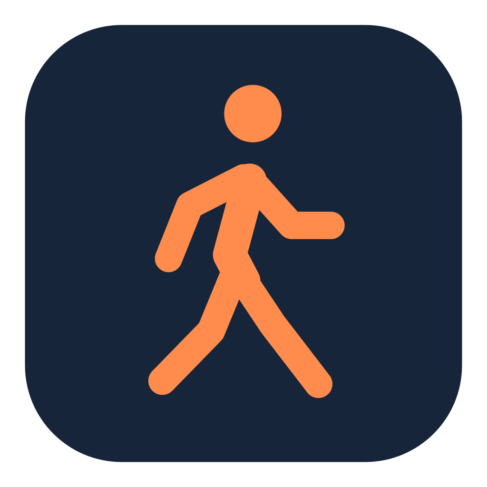

# Take a Walk



**A native macOS menu bar app that reminds you to get up, take a walk, and return when you are ready.**

Take a Walk combines a desk timer, a walking break, a visible countdown, and an audible reminder. The default rhythm is **30 minutes at your desk followed by a 10-minute walk**, with adjustable durations and a navy-and-tangerine interface.

## Why we built it

It is easy to sit down to work, become absorbed in a task, and realize much later that you have barely moved. Even with good intentions, a busy day at the computer can pass without a clear reminder to stand up and step away.

We built Take a Walk to make regular walking breaks easier to remember while leaving you in control of when they happen. You may need a moment to finish something before getting up, and you may return later than planned. The app follows those choices: a reminder asks you to take a walk, the walking timer starts when you click **Start walk**, and the next desk session waits for **I'm back**.

The original use case involved working across a Mac Mini and a MacBook Air. A desktop usually means being at a desk; a laptop can be used elsewhere. That is why the app asks for desk confirmation before counting a work session, and why each Mac keeps its own settings and timer.

The purpose is simple: **make a little space for movement during a day at the computer, with a reminder that is easy to notice and easy to control.**

### Design goals

- **A visible daily rhythm:** keep the countdown in the menu bar while you work.
- **Intentional breaks:** start the walking timer when you actually leave your chair.
- **A deliberate return:** wait for your confirmation before starting the next work session.
- **Noticeable reminders:** combine a popup with a repeating bell that can be silenced immediately.
- **Local operation:** keep preferences on your Mac and use the app without an account.
- **Simple setup:** build a small native app with Apple's tools and no third-party packages.

## Features at a glance

| Feature | What it does |
| --- | --- |
| Menu bar countdown | Shows remaining desk or walking time at the top of the screen. |
| Reminder popup | Presents the current action in a navy-and-tangerine window. |
| Repeating bell | Rings for up to 60 seconds at the end of either timer. |
| Stop ringing | Silences the sound while leaving the session state alone. |
| Test ringing | Lets you check audio directly from Settings. |
| Adjustable durations | Changes the desk, walk, and inactivity intervals. |
| Pause and resume | Pauses a desk countdown and preserves its remaining time. |
| Start a walk early | Begins a break before the desk timer finishes. |
| Inactivity detection | Marks a working session as away after the configured time without input. |
| Login startup | Can launch automatically when you log in to your Mac. |
| Independent devices | Keeps each Mac's timer and settings local to that device. |

## Run it

Requires macOS 13 or later and Apple's Command Line Tools with Swift 6 or later. Builds for Apple silicon and Intel Macs; build on each Mac to use its native architecture.

The current version has been built and inspected on an Apple silicon Mac Mini. Intel and second-device behavior still need acceptance testing. Git is needed to clone and update the repository. You can check your toolchain with `swift --version`.

1. If needed, install the tools: `xcode-select --install`.
2. Open this folder in Terminal and run `./run.command`, or double-click `run.command` in Finder.
3. Look for the walking icon in the menu bar. Confirm **I'm at my desk** (or press Enter) to start.

The first build can take a minute. The launcher installs the app at `~/Applications/Take a Walk.app` to keep it outside iCloud and give login startup a stable location. Later, open that app directly; rebuilding isn't necessary unless the source changed. Quit the running app before rebuilding it after a source update.

## Your rhythm

- **Desk:** 30 minutes by default. A popup and repeating bell ask you to walk. Ringing stops after one minute or as soon as you acknowledge it.
- **Walk:** Click **Start walk** to begin a 10-minute countdown. The desk timer stays on hold.
- **Return:** When the walk ends, another popup and repeating bell appear, again for up to one minute. A fresh desk timer starts only after you click **I'm back**. You can also return early.
- **Away:** After 10 minutes without mouse or keyboard input, the app marks you away. When input resumes, confirm you're at your desk to start a fresh timer. Sleep and screen lock also end a working desk session.
- **Controls:** **Start Walk Now** and **I'm Back on My Desk** are the first two items in the menu bar menu. Start a walk, confirm your initial desk session, or return from a walk without opening the app window. Each action is available when it applies to your current session, stops ringing, and hides the popup. The menu also provides **Show Take a Walk**, **Stop ringing**, **Pause desk timer**, **Settings**, and **Quit**. The gear in the popup also opens Settings. Hiding a popup doesn't quit the app or start a walk.

If you're in the middle of something when a walk reminder arrives, choose **Stop ringing** from the menu to silence it and hide the popup. The app waits until you choose **Start Walk Now** from the menu; your walk countdown begins at that moment. Choose **I'm Back on My Desk** when you return to start a fresh desk timer.

Settings let you change the desk, walk, and inactivity durations, mute reminder sounds, and control login startup. A changed desk duration restarts a running desk timer; an ongoing walk keeps its original remaining time. After relaunch, the app waits for desk confirmation again.

| Setting | Default | Allowed values |
| --- | --- | --- |
| Desk timer | 30 minutes | 1–240 whole minutes |
| Walk time | 10 minutes | 1–60 whole minutes |
| Mark away after | 10 minutes | 1–120 whole minutes |
| Play reminder sounds | On | On or off |
| Start when I log in | Requested on first launch | Controlled by the app and macOS Login Items |

The popup's main button changes with the session: **I'm at my desk**, **Start walk**, **I'm back**, or **Resume timer**. Closing or hiding a popup keeps the app running in the menu bar.

Use **Settings → Test ringing** to check the sound without waiting for a timer. The generated bell repeats through your Mac's current audio output at its current output volume. It does not change your system volume; if it is silent, check that the Mac is unmuted and the intended speakers or headphones are selected. Playback failures are shown in Settings.

Click **Stop ringing** in the popup, menu bar menu, or Settings to silence it without starting a walk. Starting a walk, confirming your return, closing the popup, disabling sound, locking the screen, sleeping, or quitting also stops the sound. Ringing automatically ends after one minute even when you leave the popup unanswered.

Input inactivity is an estimate of desk presence. Reading or watching a video for a long time without touching the keyboard or mouse may count as being away. Adjust the inactivity threshold to fit your work. Input during a walking break does not automatically restart the desk timer; your return still requires **I'm back**.

## Open the installed app

After the first build, open Finder, press **Command–Shift–G**, enter the following path, and press Enter:

```text
~/Applications/Take a Walk.app
```

If it is already running, click the walking icon in the menu bar and choose **Show Take a Walk**. Use **Quit Take a Walk** in that menu to exit completely.

## Login startup

The first normal launch requests startup at login using macOS Login Items. Check the actual status in the app's menu. If macOS requires approval, use **Settings → Open macOS Login Items…** to enable it. You can turn startup off in the app or System Settings. Keep the built app at a stable location; moving or deleting it can interrupt login startup. If you change its location, open it there and re-enable startup in Settings.

Login startup is requested only on the first normal launch or when you explicitly enable it in Settings. The app respects later OS-level disabling. Login behavior needs an actual logout/login check on your Mac; unit tests cannot verify it.

## Mac Mini and MacBook Air

Use the same source folder or pull the repository on each Mac, then run `./run.command` there. Each device has its own timer, settings, and login preference; sessions do not sync. On your laptop, hide the desk prompt or turn off login startup if you're using it away from your desk.

On a new Mac, clone and run:

```sh
git clone https://github.com/datawithmursalin-cloud/Take-a-walk.git
cd Take-a-walk
./run.command
```

For an existing checkout, quit the app, run `git pull --ff-only`, and run `./run.command` again to install the updated version.

## Privacy and local storage

The running app reads the system's elapsed time since the last input event to estimate inactivity. It does not record keystrokes, mouse positions, screenshots, or browsing activity.

There are no accounts, analytics, telemetry, or network requests in the app. Preferences are stored locally in macOS UserDefaults under `local.takeawalk.app`. Countdown sessions stay in memory; after relaunch, the app waits for desk confirmation again.

## Development and preview

```sh
./scripts/test.sh
./scripts/build.sh --preview
open "$HOME/Applications/Take a Walk Preview.app"
```

Preview phases: `desk`, `working`, `due`, `walking`, and `back`; pass `--args --phase desk` to the `open` command to choose a phase when launching. Preview doesn't register a login item, save settings, automatically play sounds, or run the automatic timer. You can explicitly use **Test ringing** in Settings to check audio. Quit the preview before opening the normal app.

The timer state machine is in `Sources/WalkCore`; the generated bell and its playback lifecycle are in `Sources/ReminderAudio`; native AppKit windows and macOS integrations are in `Sources/TakeAWalk`. There are no third-party dependencies. The build is locally ad-hoc signed rather than notarized for distribution.

### Project structure

| Location | Purpose |
| --- | --- |
| `Sources/WalkCore/` | Desk/walk timer state machine and settings. |
| `Sources/ReminderAudio/` | Generated bell and its one-minute playback lifecycle. |
| `Sources/TakeAWalk/` | Native windows, menu bar controls, and macOS integrations. |
| `Tests/WalkCoreTests/` | Deterministic checks for timer and audio behavior. |
| `Resources/` | App metadata, icon assets, and original logo reference. |
| `scripts/build.sh` | Builds, packages, locally signs, and installs the app. |
| `scripts/test.sh` | Runs the checks with Command Line Tools. |
| `scripts/generate-icon.swift` | Regenerates the vector logo and macOS icon sizes. |
| `agent.md` | Project decisions and working conventions. |

### Automated checks

Run `./scripts/test.sh` to execute the current **19 checks**. They cover explicit desk confirmation, timer deadlines, walk and return behavior, inactivity, pause/resume, sleep handling, settings changes, audio decoding, the 60-second ringing cutoff, early cancellation, player lifetime, and playback failures. The executable test harness works with Command Line Tools alone.

## App icon

The app uses the orange walking figure and navy background supplied by the user, recreated as vector paths for sharp edges at every size. `Resources/AppIcon.icns` is bundled into the macOS app; `Resources/AppIcon.png` is a 1024-pixel export, and `Resources/Brand/Logo.svg` is the vector version. The original reference is preserved in `Resources/Brand/Reference.png`.

To regenerate the artwork and all standard macOS icon sizes, run:

```sh
swift -module-cache-path .build/module-cache scripts/generate-icon.swift
```

The generated iconset is placed in `.build`, which is already ignored. Regular builds copy the checked-in `.icns` file and do not need to regenerate the artwork.

## Troubleshooting

| Situation | What to check |
| --- | --- |
| No visible window | Click the walking icon in the menu bar and choose **Show Take a Walk**. |
| No sound | Use **Test ringing**, check that the Mac is unmuted, and confirm the selected speakers or headphones. Check Settings for a playback error. |
| Timer is unexpectedly waiting | Confirm desk presence or **I'm back**; an away session needs confirmation. |
| App does not start at login | Check its actual login status and macOS Login Items approval. |
| Source changes are not reflected | Quit the running app, pull the latest source, and rerun `./run.command`. |
| Reminders arrive every minute | Restore your preferred durations after a short test; normal defaults are 30 minutes at the desk and a 10-minute walk. |

## Current status and manual testing

This is an initial working version, distributed as source and locally ad-hoc signed when built. It is not a notarized downloadable release. Automated checks, release builds, code-signature verification, and native UI inspection have passed on the development Mac. Actual speaker audibility, logout/login behavior, full-screen presentation, and operation on a second Mac remain acceptance checks on the relevant device.

For a quick manual test:

1. Temporarily set both desk and walk durations to **1 minute**.
2. Use **Test ringing** to check your selected audio output and **Stop ringing** to silence it.
3. Confirm desk presence and wait for the desk timer to expire.
4. Check that the popup appears and the bell rings, then click **Start walk**.
5. Wait for the walking timer to expire and confirm that the next desk timer waits for **I'm back**.
6. Restore your usual durations afterward.
